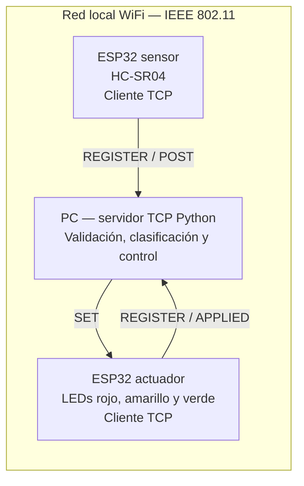

# Planificación del monorepo — Práctica 2

**Fecha de revisión:** 13 de octubre de 2026.  
**Base:** [enunciado de la práctica 2](Práctica_2.md), [informe actual](informe.md) y [Práctica 1](https://github.com/Matuidich/Practica1-IoT).  
**Versión de referencia de la práctica 1:** `36e8837cabdffbaf5aae5007a3f18af93d235f95`.

La propuesta consiste en utilizar este repositorio `Practica2-IoT` como monorepo: dos programas para ESP32, un servidor TCP en Python y sus contratos, pruebas e informe. Los tres componentes se desarrollarán y entregarán desde la misma raíz Git.

Los archivos de la práctica 1 ya están integrados en la raíz de `Practica2-IoT`: `src/`, `include/`, `doc/`, `.vscode/`, `.gitignore`, `platformio.ini` y `README.md`. La carpeta del clon fue eliminada después de verificar la integridad de los 20 archivos trasladados. La estructura del monorepo descrita a continuación es una propuesta para implementar; actualmente se han realizado la integración de archivos y la planificación.

## 1. Punto de partida y cambios necesarios

La práctica 1 utiliza C++ con Arduino y PlatformIO sobre `esp32doit-devkit-v1`. Un único ESP32 mide, clasifica y controla los tres LEDs. La práctica 2 requiere dos objetos independientes que inicien conexiones TCP hacia una computadora, donde se ejecutará la clasificación.

| Elemento revisado | Reutilización o cambio previsto |
| --- | --- |
| `include/UltrasonicSensor.h` y `src/UltrasonicSensor.cpp` | Reutilizar la clase `UltrasonicSensor` y su resultado `Measurement` en el cliente sensor. Mantener el timeout de lectura y la detección de mediciones inválidas. |
| `src/main.cpp`: `classifyDistance()` | Trasladar su lógica al servidor Python. El ESP32 sensor enviará mediciones y el actuador ejecutará comandos. |
| `src/main.cpp`: control de LEDs | Encapsularlo en `LedController`, en el segundo ESP32. Sustituir los `delay()` del parpadeo por temporización con `millis()`. |
| `setup()` de la práctica 1 | Corregir la inicialización: existe `UltrasonicSensor::begin()`, pero el programa revisado no lo llama. |
| `platformio.ini` | Conservar placa, framework y velocidad serial; crear entornos `sensor` y `actuator`. El puerto `COM5` actual debe convertirse en configuración de cada equipo. |
| `doc/informe.md` y fotografías anteriores | Utilizarlos como antecedentes y referencia de conexiones. Las evidencias de la práctica 2 deben corresponder al sistema distribuido nuevo. |
| `informe.md` de este repositorio | Completar el borrador existente: concretar rangos y protocolo, agregar circuitos de ambos objetos, clases, implementación, pruebas, resultados y secciones finales. |

El informe anterior registra una anomalía aproximadamente en el minuto 11. No se ha determinado su causa: investigar esa incidencia forma parte de la validación del nuevo sistema.

## 2. Arquitectura propuesta



Ambos ESP32 iniciarán su propia conexión al servidor y la mantendrán abierta para intercambios sucesivos. El servidor enviará `SET` por la conexión ya establecida con el actuador. La conexión sensor → servidor → actuador será el camino de control.

- **Sensor:** inicializar el HC-SR04, medir periódicamente, indicar validez, conectarse por WiFi/TCP y enviar lecturas.
- **Servidor:** registrar ambos roles, validar mensajes, clasificar distancias, producir comandos y registrar eventos.
- **Actuador:** recibir y validar comandos, mantener el estado de cada LED y actualizar el parpadeo sin detener la atención de la conexión.

El servidor usará sockets `AF_INET`/`SOCK_STREAM` y un hilo por conexión, suficiente para los dos clientes previstos. El registro compartido de dispositivos y las escrituras sobre cada conexión deberán coordinarse para evitar carreras o mensajes mezclados.

## 3. Estructura del monorepo

```text
Practica2-IoT/
├── README.md                       # Montaje, configuración y ejecución
├── PLANIFICACION.md
├── Práctica_2.md                    # Enunciado
├── informe.md                      # Informe final exigido
├── .gitignore
├── firmware/
│   ├── platformio.ini              # Entornos sensor y actuator
│   ├── include/
│   │   ├── Config.example.h         # Pines y configuración de ejemplo
│   │   └── Config.local.h           # Datos de red locales; ignorado por Git
│   ├── src/
│   │   ├── sensor/main.cpp
│   │   └── actuator/main.cpp
│   └── lib/
│       ├── UltrasonicSensor/src/    # Clase y cabecera reutilizadas
│       ├── Communication/src/       # WiFi, TCP y codificación del protocolo
│       └── LedController/src/       # Salidas y parpadeo por temporización
├── server/
│   ├── __init__.py
│   ├── __main__.py                  # python -m server
│   ├── config.py
│   ├── protocol.py
│   ├── tcp_server.py
│   ├── controller.py
│   └── tests/
├── contracts/
│   ├── protocol.md                 # Especificación común C++ / Python
│   └── protocol-cases.json          # Mensajes válidos, inválidos y esperados
├── tools/
│   ├── simulate_sensor.py
│   ├── simulate_actuator.py
│   └── verify.ps1                  # Compilación y pruebas desde la raíz
├── docs/
│   ├── diagrams/                   # Arquitectura, secuencia, clases y circuitos
│   ├── hardware.md                 # Materiales, pines y montaje de cada objeto
│   └── evidence/                   # CSV, logs, fotos y evidencias de pruebas
└── .github/workflows/checks.yml     # Pruebas del servidor y dos compilaciones
```

Un único proyecto PlatformIO permite compartir placa, framework y bibliotecas, mientras cada entorno selecciona solamente el código de su objeto mediante `build_src_filter`. PlatformIO documenta tanto los [entornos de configuración](https://docs.platformio.org/en/stable/projectconf/sections/env/index.html) como los [filtros de fuentes](https://docs.platformio.org/en/latest/projectconf/sections/env/options/build/build_src_filter.html). Las bibliotecas propias se organizarán en [directorios dentro de `lib/`](https://docs.platformio.org/en/stable/projectconf/sections/platformio/options/directory/lib_dir.html).

Configuración inicial propuesta, a validar al compilar:

```ini
[env]
platform = espressif32
board = esp32doit-devkit-v1
framework = arduino
monitor_speed = 115200

[env:sensor]
build_src_filter = -<*> +<sensor/>

[env:actuator]
build_src_filter = -<*> +<actuator/>
```

Después de una compilación satisfactoria, fijar la versión de la plataforma utilizada para que ambos integrantes y CI reproduzcan el mismo entorno.

### Integración de la práctica 1 en Git

Los archivos originales ya se encuentran bajo la raíz del repositorio de la práctica 2. El informe anterior se conserva en `doc/informe.md` y el borrador de la práctica 2 en `informe.md`.

1. Crear una rama de preparación en el repositorio actual, preservando los cambios ya existentes en `informe.md` y el enunciado.
2. Reorganizar las fuentes actuales de `src/` e `include/` para ubicar la clase del sensor en `firmware/lib/UltrasonicSensor/`.
3. Adaptar las funciones del programa anterior a los nuevos componentes sensor, servidor y actuador; conservar la documentación y las fotografías originales en `doc/` como antecedentes.
4. Documentar el repositorio y commit de procedencia en el README. El historial de la práctica 1 seguirá disponible en su repositorio de GitHub.
5. Versionar directamente las fuentes y la documentación en el repositorio actual: quien clone `Practica2-IoT` debe recibir todos los archivos necesarios.

El `.gitignore` también cubrirá `.pio/`, entornos virtuales, `__pycache__/`, credenciales locales y logs temporales. Las evidencias seleccionadas de `docs/evidence/` sí formarán parte de la entrega.

## 4. Diseño modular y lógica de control

| Componente | Clases y responsabilidades previstas |
| --- | --- |
| Firmware sensor | `UltrasonicSensor`: adquisición y validez. `WifiConnection`: conectividad WiFi. `TcpConnection`: conexión, recepción y envío. `ProtocolCodec`: mensajes y delimitación. |
| Firmware actuador | Reutilizar las clases de comunicación. `LedController`: estados `on`, `off`, `blink_2` y `blink_4`, actualizados mediante `millis()`. |
| Servidor | `TcpServer` y `ClientSession`: conexiones y buffers. `DeviceRegistry`: asociación entre rol y conexión. `ProtocolCodec`: validación. `DistanceClassifier`: rangos. `ControlService`: medición → comando. |

Mantener los límites exactos de la práctica 1 facilita la reutilización y evita introducir cambios de comportamiento innecesarios:

| Medición válida en centímetros | Estado | Rojo | Amarillo | Verde |
| --- | --- | --- | --- | --- |
| `0 < d < 20` | Cercano | `blink_4` | `off` | `off` |
| `20 <= d <= 40` | Intermedio | `off` | `on` | `off` |
| `d > 40` | Lejano | `off` | `off` | `on` |
| Medición inválida | Inválido | `off` | `off` | `off` |

`20 cm` y `40 cm` pertenecen al rango intermedio. Se rechazarán distancias no finitas o menores o iguales a cero. Los tres rangos cubren las distancias positivas válidas sin solapamientos. Se propone verificar la exactitud física inicialmente entre **10 y 60 cm**, el intervalo ya explorado en la práctica 1; la exactitud fuera de ese intervalo requeriría pruebas adicionales.

Propuestas operativas:

- Muestrear cada **250 ms**, objetivo de 4 lecturas/s para disponer de margen sobre el mínimo declarado de 2 lecturas/s.
- Enviar un comando por medición, aunque el rango se mantenga: el actuador podrá detectar si deja de recibir datos recientes.
- Para `blink_4`, alternar el LED cada **125 ms**; para `blink_2`, cada **250 ms**. Repetir el mismo comando no debe reiniciar la fase del parpadeo.
- Arrancar con todos los LEDs apagados. Aplicar el mismo estado ante medición inválida, desconexión o ausencia de comandos durante **2 s**. Ese timeout será una política de recuperación, distinta del objetivo de respuesta durante operación normal.
- Recuperar WiFi/TCP con reintentos temporizados y volver a registrar el rol en cada conexión nueva. No acumular ni reproducir una cola de lecturas antiguas tras reconectar.

## 5. Contrato del protocolo antes de implementar

Conservar `REGISTER`, `POST` y `SET` del informe actual y precisar su formato. Propuesta: texto ASCII, un mensaje por línea terminada en `\n`, punto como separador decimal y un máximo de **256 bytes antes del terminador**. Se podrá aceptar `\r\n` eliminando el `\r` final.

TCP transporta un flujo de bytes: una lectura puede contener una parte del mensaje o varios mensajes. Cada receptor necesitará un buffer que extraiga líneas completas y conserve los bytes pendientes. El emisor deberá completar las escrituras parciales. Esta necesidad se explica en la [documentación oficial de sockets de Python](https://docs.python.org/3/howto/sockets.html#using-a-socket).

Ejemplos de la versión propuesta; cada línea enviada incluirá su terminador:

```text
REGISTER type=sensor version=1
REGISTER type=actuator version=1
OK type=sensor version=1
OK type=actuator version=1
POST seq=42 distance=19.80
SET seq=42 redLed=blink_4, yellowLed=off, greenLed=off
APPLIED seq=42
POST seq=43 status=invalid
SET seq=43 redLed=off, yellowLed=off, greenLed=off
ERROR code=BAD_MESSAGE
```

`seq` identificará una medición dentro de la sesión del sensor y permitirá relacionar la lectura con el comando y su confirmación. `APPLIED` confirmará la instalación del estado de salidas, con aplicación inmediata de su primera salida; no significa que haya transcurrido un ciclo completo de parpadeo. Versiones, confirmaciones y secuencias son ampliaciones propuestas al borrador actual y deben quedar reflejadas en el informe.

La especificación deberá resolver antes de programar:

1. Orden y cantidad de argumentos, espacios, comas de `SET`, valores permitidos y mensajes incompletos o demasiado largos.
2. Registro obligatorio antes de otros mensajes; `POST` permitido al sensor y `APPLIED` al actuador. `SET` procede del servidor.
3. Un cliente activo por rol. Rechazar un registro duplicado y retirar las sesiones cerradas para permitir la reconexión.
4. Comportamiento si el sensor llega antes que el actuador: continuar atendiendo conexiones y no guardar una cola de comandos; esperar una lectura nueva cuando ambos estén disponibles.
5. Tratamiento diferenciado de medición inválida y mensaje mal formado: la primera provoca LEDs apagados; el segundo genera un error y queda registrado. El timeout de datos recientes también debe llevar las salidas a apagado.
6. Reinicio de sesiones y de secuencias tras una reconexión; los logs incluirán sesión, rol y `seq` para distinguir eventos.

## 6. Fases de ejecución y criterios de cierre

Las duraciones son estimaciones de esfuerzo y dependen del montaje y de la experiencia del grupo. El enunciado fija la entrega para el **13 de octubre de 2026**, fecha de esta revisión; por eso conviene ejecutar por prioridades y comprobar pronto el recorrido completo con hardware.

| Fase | Trabajo | Dependencia | Esfuerzo orientativo | Criterio de cierre |
| --- | --- | --- | --- | --- |
| 0. Preparación | Verificar Python, PlatformIO, dos ESP32, sensor, LEDs, red y acceso al PC. Definir IP, puerto y pines. | Ninguna | 0,5–1 h | Herramientas ejecutables y ambos objetos pueden alcanzar al servidor. |
| 1. Monorepo | Crear estructura, entornos, configuración de ejemplo y reglas Git; reubicar la clase del sensor ya integrada. | Fase 0 | 0,5–1 h | Dos objetivos de firmware compilables y entrada del servidor ejecutable. |
| 2. Contrato y servidor | Cerrar protocolo; implementar registro, buffers, clasificación, comandos y simuladores. | Fase 1 | 2–3 h | Dos clientes simulados intercambian mensajes y superan pruebas de rangos y protocolo. |
| 3. Dos firmwares | Sensor con WiFi/TCP; actuador con recepción y parpadeo temporizado; inicialización y reconexión. | Fase 1 y contrato cerrado | 2–4 h | Ambos ESP32 se registran y cada uno cumple su responsabilidad. |
| 4. Integración | Ejecutar sensor → servidor → actuador; probar límites, orden de conexión, datos inválidos y desconexiones. | Fases 2 y 3 | 1,5–2,5 h | RF1–RF4 funcionan en la red WiFi real. |
| 5. Validación y entrega | Medir atributos, guardar evidencias, completar diagramas e informe, ensayar demo y defensa. | Fase 4 | 2–3 h | Requisitos trazables a resultados y repositorio completo accesible para el docente. |

La fase 2 y la fase 3 pueden avanzar en paralelo **después de acordar el protocolo**. Para dos integrantes, un reparto sugerido es servidor/pruebas y firmware/montaje, con revisión cruzada e integración conjunta. Cada integrante debe crear commits con su propia cuenta y poder explicar los tres componentes.

**Prioridad P0:** dos ESP32 reales, servidor TCP, tres rangos, protocolo delimitado, pruebas funcionales y mediciones de los cuatro atributos mínimos, diagramas e informe exigidos.  
**Prioridad P1:** automatización en CI, simuladores más completos y mejoras de diagnóstico. La recuperación básica y la atención de mensajes parciales pertenecen a P0 por su relación con la estabilidad.

La demo temprana orienta el trabajo restante; la entrega final debe incluir todo lo exigido por el enunciado. No se necesitan una interfaz web, base de datos ni contenedores para esta arquitectura.

## 7. Plan de pruebas y evidencias

Los códigos RF de esta tabla corresponden al **enunciado**. El informe actual desglosa esos requisitos en RF01–RF05: conservar ese detalle, pero agregar su correspondencia explícita para evitar confundir RF2 del enunciado con RF02 del borrador.

| Requisito o propiedad | Prueba prevista | Criterio de aceptación / evidencia |
| --- | --- | --- |
| RF1: medición | Referencias físicas a 10, 20, 30, 40, 50 y 60 cm, al menos 10 lecturas por punto. | CSV con cada lectura y fotografías de la referencia física. |
| RF2: clasificación | Pruebas deterministas con 19,99; 20; 20,01; 39,99; 40 y 40,01 cm, además de valores interiores. | 20 y 40 son intermedios; ninguna entrada válida queda sin rango. |
| RF3: actuación | Recorrer los tres rangos con hardware y enviar los estados definidos. | Un comportamiento por rango; video o captura de señales para verificar 4 Hz y exclusión entre LEDs. |
| RF4: comunicación | Dos conexiones reales sobre WiFi, registro de roles y flujo completo. | Lecturas en el PC y comandos recibidos en el segundo ESP32, con logs correlacionados. |
| Protocolo | Fraccionar una línea entre varias escrituras y agrupar varias líneas en una sola; probar sintaxis, longitud, roles y valores inválidos. | Mensajes completos procesados una vez, fragmentos conservados y errores controlados. |
| Recuperación | Alterar el orden de conexión; desconectar cada cliente y reiniciar el servidor. | LEDs apagados ante pérdida de datos y recuperación con registro nuevo, sin bloqueo ni reproducción de datos antiguos. |
| Estabilidad | Operación normal continua durante **15 minutos**, cubriendo la incidencia previa del minuto 11. | Al menos 10 minutos sin reinicios ni bloqueos; registrar también el resultado del intervalo completo y las incidencias. |
| Exactitud | Calcular `abs(lectura - referencia)` para cada muestra en 10–60 cm. | Error absoluto máximo observado ≤ 3 cm; el promedio puede informarse como dato adicional. |
| Respuesta | Capturar el inicio de adquisición mediante un marcador del sensor y el cambio físico del actuador, usando video o analizador lógico con una referencia temporal común. | Máximo observado ≤ 1 s en cambios de rango; registrar método, resolución y repeticiones. |
| Muestreo | Contar adquisiciones durante 60 s en el sensor y contrastarlas con recepciones del servidor. | Al menos 120 adquisiciones/60 s y registro de pérdidas o pausas; informar también distribución de intervalos. |
| Modularidad | Revisar responsabilidades y explicar clases y mensajes. | Diagrama de clases coherente con las fuentes; documentación y enlaces desde el informe. |

Los logs de recepción y `APPLIED` ayudan a diagnosticar, pero por sí solos no prueban toda la latencia desde la adquisición. No restar timestamps de dispositivos distintos sin sincronizar sus relojes. Las pruebas sintéticas de frontera verifican la clasificación exacta; las pruebas físicas también deben considerar el error de medición.

## 8. Ejecución y verificación previstas

Estos comandos corresponden a la estructura futura, no a código ya implementado:

```powershell
# Ejecutar desde la raíz del monorepo.
python -m server --host 0.0.0.0 --port 5000
python -m unittest discover -s server/tests

# Compilar cada objeto por separado.
pio run -d firmware -e sensor
pio run -d firmware -e actuator

# Identificar los puertos antes de cargar cada programa.
pio device list
pio run -d firmware -e sensor -t upload --upload-port COM_SENSOR
pio run -d firmware -e actuator -t upload --upload-port COM_ACTUATOR
```

`COM_SENSOR` y `COM_ACTUATOR` son marcadores que se sustituirán por los puertos reales. En ambos ESP32 se configurará la **IP local del PC**, junto con SSID, contraseña y puerto; `0.0.0.0` es la dirección de escucha del servidor, no su dirección de destino. Documentar en el README el permiso de entrada TCP para el puerto elegido en el firewall del PC y verificar que la red permita comunicación entre equipos.

**Estado observado en esta sesión:** `python --version` resuelve a un acceso de Microsoft Store y no ejecuta un intérprete. `pio`/`platformio` no están disponibles en el PATH revisado. La fase 0 debe resolver el entorno de ejecución antes de intentar estas verificaciones.

`tools/verify.ps1` y CI deberán ejecutar las pruebas del servidor y ambas compilaciones. Esas verificaciones complementan las pruebas físicas; no sustituyen las mediciones ni la demo.

## 9. Cierre de la entrega

- [ ] README con materiales, pines por objeto, versiones, configuración y pasos reproducibles.
- [ ] Dos firmwares y servidor TCP, documentados y disponibles al clonar este repositorio.
- [ ] `informe.md` con las ocho secciones del enunciado: requerimientos; análisis y diseño; desarrollo; pruebas; resultados; conclusiones; recomendaciones; anexos.
- [ ] Diagramas propios de arquitectura, circuito de **cada** objeto, clases y secuencia con conexiones y mensajes.
- [ ] Circuitos con alimentación, tierra común en cada montaje y componentes de adaptación/protección necesarios para los módulos usados, además de pines y resistencias de los LEDs.
- [ ] Contrato del protocolo y rangos idénticos en código, informe y pruebas.
- [ ] Resultados cuantificables de estabilidad, exactitud, respuesta y muestreo; evidencias de la práctica 2 y análisis de incidencias.
- [ ] Commits verificables de ambos integrantes con sus propias cuentas.
- [ ] Ensayo de demo con los tres rangos y sus fronteras; defensa individual de arquitectura TCP/IP, protocolo, código y circuitos.
- [ ] Contenido final en GitHub, accesible para el docente dentro del plazo; enlace enviado por un integrante mediante LMS-UCB.

**Primer hito concreto:** preparar la estructura Git y los dos entornos de PlatformIO, reutilizar `UltrasonicSensor` con su inicialización corregida y cerrar `contracts/protocol.md`. Ese hito deja definidos los componentes y el contrato para desarrollar servidor y firmwares sin decisiones incompatibles.
