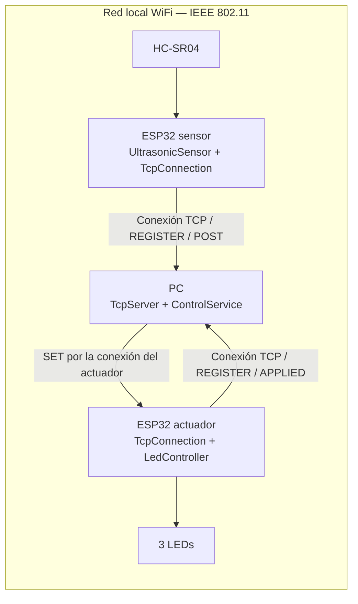
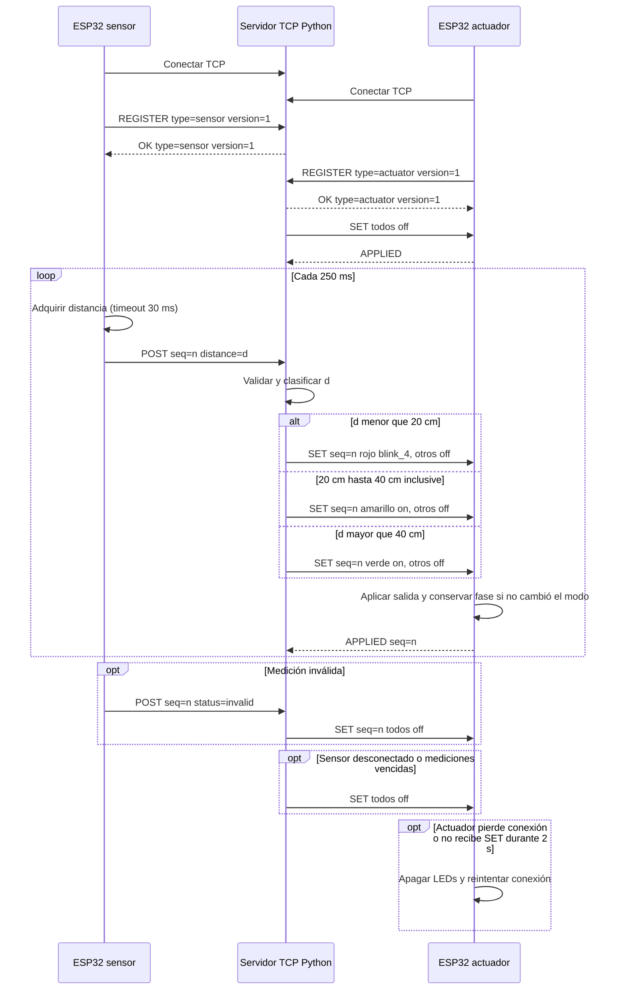
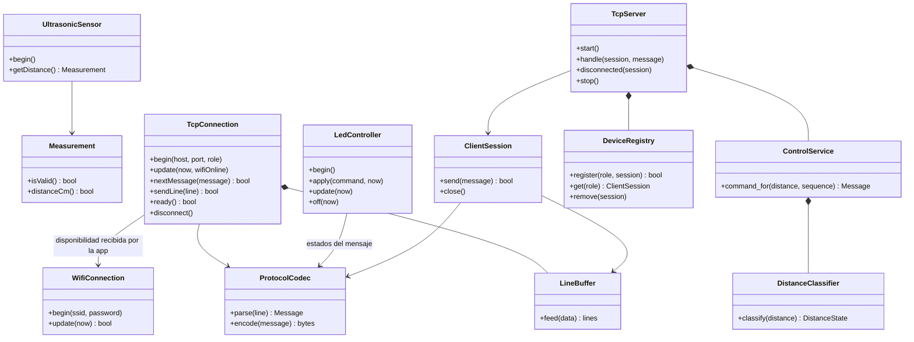

# Diagramas de la implementación

Complemento del [informe existente](../../informe.md). Los circuitos de los dos
objetos están en [sensor.svg](sensor.svg) y [actuator.svg](actuator.svg); su montaje
se describe en [hardware.md](../hardware.md).

## Arquitectura

## Secuencia

Las etiquetas abreviadas `todos off` y `otros off` representan los tres argumentos
completos descritos en el [contrato](../../contracts/protocol.md).

## Clases

`ProtocolCodec` y `LineBuffer` tienen implementaciones C++ y Python con la misma
gramática; sus firmas concretas cambian según el lenguaje (`push` en C++, `feed`
en Python). El diagrama resume ambas implementaciones. Las aplicaciones ESP32
coordinan adquisición, conectividad y actuación en sus `setup()`/`loop()`.
