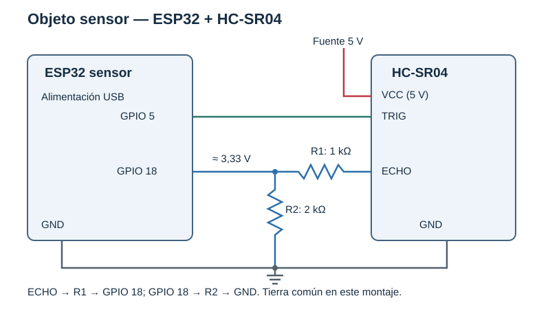
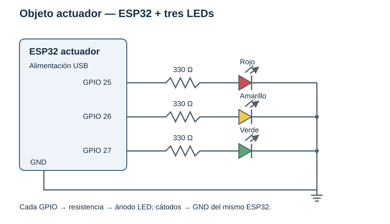

# Montaje de los dos objetos inteligentes

Componentes previstos: dos ESP32 DOIT DevKit V1, HC-SR04, LEDs rojo/amarillo/verde,
tres resistencias de 330 Ω, resistencias de 1 kΩ y 2 kΩ para ECHO, protoboard,
cables, dos conexiones USB y una computadora alcanzable por la red WiFi.

## Objeto sensor

| Señal | Conexión |
| --- | --- |
| HC-SR04 VCC | Fuente de 5 V del montaje. |
| HC-SR04 GND | GND común con el ESP32 sensor. |
| TRIG | GPIO 5. |
| ECHO | Resistencia R1 de 1 kΩ hasta nodo conectado a GPIO 18. |
| Nodo GPIO 18 | Resistencia R2 de 2 kΩ hasta GND. |
| ESP32 | Alimentación USB. |

El HC-SR04 devuelve ECHO con lógica de 5 V, por lo que se adapta antes de llegar
al GPIO. El divisor propuesto da `5 × 2 / (1 + 2) ≈ 3,33 V`. La
[guía del HC-SR04 de Adafruit](https://learn.adafruit.com/ultrasonic-sonar-distance-sensors/pinouts)
documenta la alimentación de 5 V y la necesidad de reducir ECHO para dispositivos
de 3 V. Confirmar el módulo concreto y medir el nodo antes de conectar el GPIO.

## Objeto actuador

| LED | Ánodo | Cátodo |
| --- | --- | --- |
| Rojo | GPIO 25 a través de 330 Ω. | GND del ESP32 actuador. |
| Amarillo | GPIO 26 a través de 330 Ω. | GND del ESP32 actuador. |
| Verde | GPIO 27 a través de 330 Ω. | GND del ESP32 actuador. |

Cada LED tiene su propia resistencia. La salida HIGH enciende el LED y LOW lo apaga.
Los dos objetos se comunican por WiFi y no necesitan un cable de datos entre ellos.
Cada montaje debe compartir tierra entre su ESP32 y sus propios componentes.

## Puesta en marcha

1. Confirmar placa, polaridades, pines y divisor ECHO con el montaje sin energía.
2. Completar `firmware/include/Config.local.h` con datos de la red e IP del PC.
3. Iniciar el servidor y comprobar conectividad/firewall en la LAN.
4. Identificar los puertos USB y cargar `sensor` en una placa y `actuator` en la otra.
5. Observar `WiFi IP` y `TCP registered` en los dos monitores seriales.
6. Recorrer los tres rangos y guardar fotografías del montaje real en `docs/evidence/`.

Estos esquemas describen el montaje previsto por el código. Las fotografías y las
mediciones físicas deben incorporarse cuando se prueben los dos objetos reales.
