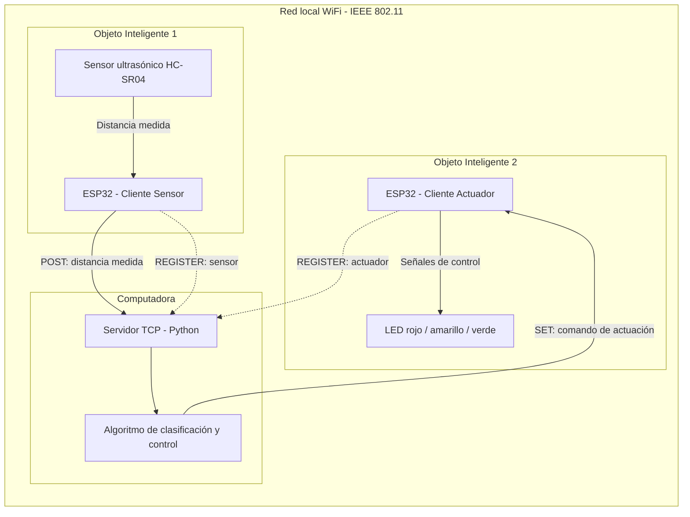
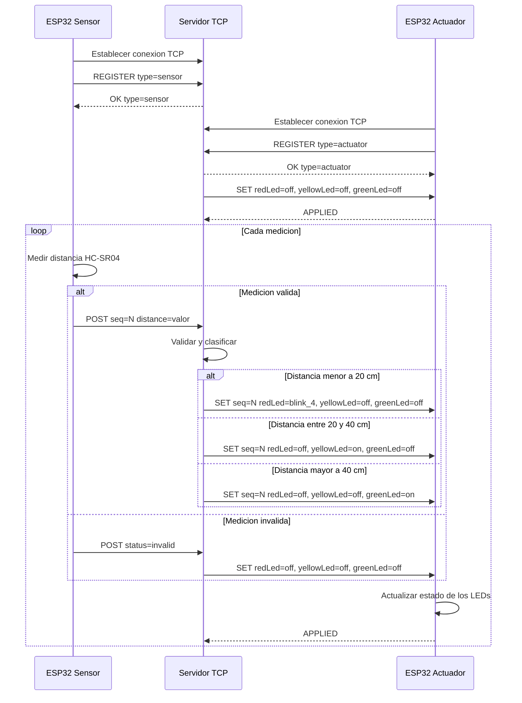

# Práctica 2 — Integración de Objetos Inteligentes con TCP/IP

**Asignatura:** Internet de las Cosas (SIS-234)  
**Carrera:** Ingeniería de Sistemas  
**Universidad:** Universidad Católica Boliviana  
**Integrantes:**
- Mateo Rojas Campos
- Lucia Escobar Galaburda

**Fecha de entrega:** 13 de octubre de 2026

---

## 1. Requerimientos Funcionales y No Funcionales

### 1.1 Descripción general

El proyecto consiste en el desarrollo de un sistema distribuido de objetos inteligentes que se comunican mediante sockets TCP sobre una red WiFi (IEEE 802.11).

El sistema está compuesto por tres componentes principales:

1. **Objeto inteligente sensor:** dispositivo ESP32 conectado a un sensor ultrasónico, encargado de medir distancias y transmitir los datos al servidor.
2. **Servidor TCP:** aplicación ejecutada en una computadora, responsable de recibir las mediciones, clasificarlas según los rangos establecidos y generar comandos de control.
3. **Objeto inteligente actuador:** dispositivo ESP32 encargado de recibir los comandos enviados por el servidor y controlar los actuadores correspondientes.

Ambos objetos inteligentes funcionan como clientes TCP y establecen conexiones independientes con el servidor.

Esta arquitectura permite separar las responsabilidades de adquisición de datos, procesamiento y actuación.

### 1.2 Requerimientos funcionales

| Código | Requerimiento | Descripción | Criterio de verificación |
|--------|---------------|-------------|-------------------------|
| RF01 | Medición de distancia | El ESP32 sensor debe medir la distancia entre el sensor ultrasónico y un objeto, expresada en centímetros. | Comparar las mediciones obtenidas con distancias físicas conocidas. |
| RF02 | Comunicación TCP | El ESP32 sensor debe transmitir sus mediciones al servidor mediante sockets TCP sobre WiFi. | Verificar la recepción de los mensajes en el servidor. |
| RF03 | Clasificación de distancias | El servidor debe clasificar cada medición válida en tres rangos contiguos y sin solapamiento. | Probar valores dentro de cada rango y exactamente en sus fronteras. |
| RF04 | Control de actuadores | El servidor debe enviar comandos al ESP32 actuador según el rango de distancia identificado. | Verificar que cada rango produzca el comportamiento correspondiente. |
| RF05 | Protocolo de aplicación | Los clientes y el servidor deben intercambiar mensajes utilizando un protocolo de aplicación definido por el grupo. | Comprobar el formato, contenido y secuencia de los mensajes intercambiados. |

### 1.3 Requerimientos no funcionales

Los valores establecidos representan objetivos de diseño que deberán verificarse experimentalmente durante la etapa de pruebas.

| Código | Atributo | Valor objetivo | Método de verificación |
|--------|----------|----------------|------------------------|
| RNF01 | Estabilidad | Operación continua durante al menos 10 minutos sin reinicios ni bloqueos. | Ejecutar el sistema durante 10 minutos, registrando interrupciones y errores. |
| RNF02 | Exactitud | Error absoluto máximo de 3 cm respecto a una referencia física dentro del rango de trabajo declarado. | Comparar múltiples lecturas con una cinta métrica y calcular el error absoluto. |
| RNF03 | Tiempo de respuesta | Máximo 1 segundo desde la medición hasta la actuación. | Medir el tiempo extremo a extremo mediante marcas de tiempo sincronizadas o análisis de video. |
| RNF04 | Frecuencia de muestreo | Al menos 2 lecturas por segundo. | Registrar la cantidad de mediciones realizadas durante un intervalo conocido. |
| RNF05 | Mantenibilidad | Código modular, orientado a objetos y documentado. | Revisar la separación de responsabilidades, las clases y la documentación del código. |

### 1.4 Definición de rangos y lógica de control

El servidor TCP clasifica las mediciones recibidas del ESP32 sensor y determina el comportamiento de los tres LEDs conectados al ESP32 actuador.

Los rangos de distancia y sus acciones correspondientes son:

| Distancia medida | LED rojo | LED amarillo | LED verde |
|---|---|---|---|
| 0 < d < 20 cm | Parpadea a 4 Hz | Apagado | Apagado |
| 20 ≤ d ≤ 40 cm | Apagado | Encendido | Apagado |
| d > 40 cm | Apagado | Apagado | Encendido |
| Medición inválida | Apagado | Apagado | Apagado |

Los intervalos son contiguos y no presentan superposiciones para las distancias válidas positivas. Los valores de exactamente 20 cm y 40 cm pertenecen al rango intermedio.

El servidor genera comandos `SET` para indicar al actuador el estado correspondiente de cada LED. Cuando se recibe una medición inválida, se ordena apagar los tres LEDs.

Para verificar la clasificación se contemplan pruebas con valores próximos a las fronteras de 20 y 40 cm, incluyendo los propios límites. El funcionamiento físico de los LEDs se comprobará durante las pruebas del prototipo.

### 1.5 Matriz de trazabilidad

La matriz de trazabilidad permitirá relacionar cada requerimiento con los componentes responsables y las pruebas utilizadas para verificar su cumplimiento.

| Requerimiento | Componente responsable | Prueba prevista |
|---------------|------------------------|-----------------|
| RF01 | ESP32 sensor | Medición de distancias conocidas |
| RF02 | ESP32 sensor y servidor TCP | Recepción de mediciones |
| RF03 | Servidor TCP | Clasificación y valores de frontera |
| RF04 | Servidor TCP y ESP32 actuador | Respuesta de actuadores por rango |
| RF05 | Clientes TCP y servidor | Validación de mensajes |
| RNF01 | Sistema completo | Prueba de estabilidad |
| RNF02 | ESP32 sensor | Prueba de exactitud |
| RNF03 | Sistema completo | Medición de respuesta extremo a extremo |
| RNF04 | ESP32 sensor | Conteo de lecturas por segundo |
| RNF05 | Código fuente | Revisión de modularidad y documentación |

Los resultados y las evidencias correspondientes se incorporarán en la sección de Pruebas y Validaciones.


---

## 2. Análisis y Diseño

### 2.1 Arquitectura del sistema

El sistema utiliza una arquitectura cliente-servidor, en la cual dos objetos inteligentes ESP32 establecen conexiones TCP independientes con un servidor central ejecutado en una computadora.

Los dispositivos se comunican a través de una red local WiFi basada en el estándar IEEE 802.11.

La arquitectura está organizada en tres componentes:

1. **Cliente sensor:** ESP32 conectado a un sensor ultrasónico HC-SR04. Se encarga de obtener mediciones de distancia y transmitirlas al servidor mediante sockets TCP.

2. **Servidor TCP:** aplicación ejecutada en una computadora. Recibe las mediciones, aplica un algoritmo de clasificación según los rangos de distancia y genera los comandos correspondientes.

3. **Cliente actuador:** ESP32 conectado a tres LEDs. Recibe los comandos del servidor y ejecuta las acciones indicadas.

El procesamiento de las mediciones se realiza en el servidor, mientras que los dispositivos ESP32 se encargan de la adquisición de datos y la actuación.

### 2.2 Diagrama de arquitectura

El siguiente diagrama representa los componentes del sistema, sus responsabilidades y el intercambio de información mediante conexiones TCP.



**Descripción del flujo de comunicación:**

1. Ambos ESP32 se conectan a la misma red WiFi que permite alcanzar al servidor.
2. El servidor TCP permanece a la espera de conexiones entrantes.
3. Cada ESP32 establece su propia conexión TCP con el servidor.
4. Los clientes se identifican mediante un mensaje de registro.
5. El ESP32 sensor mide la distancia y envía los datos al servidor.
6. El servidor procesa la medición y determina el rango correspondiente.
7. El servidor envía el comando de actuación al segundo ESP32.
8. El ESP32 actuador interpreta el comando y modifica el estado de los LEDs.

**Nota:** Los nombres y formatos de los mensajes se verificarán con el protocolo de aplicación implementado por el grupo.


### 2.3 Diagrama de secuencia

El diagrama de secuencia representa el intercambio de mensajes entre el ESP32 sensor, el servidor TCP y el ESP32 actuador.

Inicialmente, ambos dispositivos establecen conexiones TCP independientes con el servidor y se identifican mediante el comando `REGISTER`. El servidor confirma el registro mediante `OK`.

Posteriormente, el ESP32 sensor envía periódicamente mediciones de distancia mediante el comando `POST`. El servidor valida y clasifica cada medición y transmite un comando `SET` al ESP32 actuador. Este último actualiza los LEDs y confirma la aplicación del comando mediante `APPLIED`.

El siguiente diagrama representa el flujo de comunicación del sistema:



**Descripción de la secuencia:**

1. El servidor TCP inicia su ejecución y queda a la espera de conexiones.
2. El ESP32 sensor establece una conexión TCP y se registra mediante `REGISTER type=sensor`.
3. El ESP32 actuador establece otra conexión TCP y se registra mediante `REGISTER type=actuator`.
4. El servidor confirma los registros mediante `OK`.
5. El ESP32 sensor obtiene una medición utilizando el HC-SR04.
6. El sensor transmite la medición mediante `POST`, incluyendo su número de secuencia cuando corresponde.
7. El servidor valida la información y determina el rango de distancia.
8. El servidor genera y transmite el comando `SET` correspondiente.
9. El ESP32 actuador interpreta el comando y actualiza los LEDs.
10. El actuador confirma la aplicación mediante `APPLIED`.
11. El proceso continúa mientras los dispositivos permanecen conectados. Ante una medición inválida, el sistema ordena apagar los tres LEDs.

Los mensajes se intercambian sobre conexiones TCP independientes. El servidor centraliza la lógica de clasificación y los ESP32 realizan las tareas de medición y actuación.


### 2.4 Especificación del protocolo de aplicación

#### 2.4.1 Descripción general

El sistema utiliza un protocolo de aplicación para permitir el intercambio de información entre los dos clientes ESP32 y el servidor TCP.

El protocolo funciona sobre TCP/IP mediante una red WiFi (IEEE 802.11) y define los comandos necesarios para identificar los dispositivos, transmitir las mediciones del sensor y controlar los actuadores.

Se utilizan tres comandos principales:

- `REGISTER`: registra e identifica un dispositivo cliente.
- `POST`: transmite una medición de distancia al servidor.
- `SET`: envía instrucciones de control al dispositivo actuador.

#### 2.4.2 Comando REGISTER

El comando `REGISTER` permite que cada dispositivo ESP32 se identifique ante el servidor TCP.

**Dirección:** Cliente → Servidor

**Argumento:** `type`

**Valores permitidos:**
- `sensor`: identifica al dispositivo encargado de medir distancias.
- `actuator`: identifica al dispositivo encargado de controlar los LEDs.

**Formato del mensaje:**

`REGISTER type=<tipo>`

**Ejemplos:**

```text
REGISTER type=sensor
REGISTER type=actuator
```

El servidor utiliza esta información para distinguir las conexiones de los clientes y determinar la función de cada dispositivo.

#### 2.4.3 Comando POST

El comando `POST` permite que el ESP32 sensor transmita al servidor las distancias obtenidas mediante el sensor ultrasónico.

**Dirección:** Cliente sensor → Servidor

**Argumento:** `distance`

**Unidad:** centímetros (cm)

**Formato del mensaje:**

`POST distance=<valor>`

**Ejemplos:**

```text
POST distance=9
POST distance=11
POST distance=15
```

El servidor recibe el valor de distancia y lo procesa mediante el algoritmo de clasificación para determinar el comando de actuación correspondiente.

#### 2.4.4 Comando SET

El comando `SET` permite que el servidor TCP controle los LEDs conectados al ESP32 actuador.

**Dirección:** Servidor → Cliente actuador

**Argumentos:**

| Argumento | Descripción |
|-----------|-------------|
| `redLed` | Control del LED rojo. |
| `yellowLed` | Control del LED amarillo. |
| `greenLed` | Control del LED verde. |

**Valores permitidos:**

| Valor | Significado |
|-------|-------------|
| `on` | Enciende el LED. |
| `off` | Apaga el LED. |
| `blink_2` | Hace parpadear el LED a 2 Hz. |
| `blink_4` | Hace parpadear el LED a 4 Hz. |

**Formato del mensaje:**

`SET redLed=<estado>, yellowLed=<estado>, greenLed=<estado>`

**Ejemplos:**

```text
SET redLed=blink_4, yellowLed=off, greenLed=off
SET redLed=off, yellowLed=on, greenLed=off
SET redLed=off, yellowLed=off, greenLed=on
```

El ESP32 actuador interpreta los valores recibidos y actualiza el comportamiento de los LEDs.

#### 2.4.5 Secuencia de intercambio de mensajes

El intercambio de información entre los dispositivos sigue el siguiente procedimiento:

1. El servidor TCP inicia su ejecución y queda a la espera de conexiones.
2. El ESP32 sensor establece una conexión TCP y envía `REGISTER type=sensor`.
3. El ESP32 actuador establece una conexión TCP independiente y envía `REGISTER type=actuator`.
4. El ESP32 sensor obtiene una medición de distancia.
5. El sensor transmite la medición mediante `POST distance=<valor>`.
6. El servidor procesa la distancia y determina el estado correspondiente de los actuadores.
7. El servidor transmite un comando `SET` al ESP32 actuador.
8. El actuador interpreta el mensaje y actualiza los LEDs.
9. El proceso de medición, transmisión y actuación se repite continuamente.

#### 2.4.6 Relación con el modelo TCP/IP

El protocolo de comunicación del sistema se organiza en las siguientes capas:

| Capa | Tecnología utilizada | Función |
|------|----------------------|---------|
| Aplicación | Protocolo REGISTER, POST y SET | Define los mensajes intercambiados entre los dispositivos. |
| Transporte | TCP | Proporciona comunicación orientada a conexión y entrega ordenada y confiable de datos. |
| Internet | IP | Permite el direccionamiento y envío de paquetes entre los dispositivos. |
| Acceso a la red | IEEE 802.11 (WiFi) | Permite la comunicación inalámbrica dentro de la red local. |

Esta organización permite que los dispositivos intercambien información mediante un protocolo de aplicación definido específicamente para el sistema.

